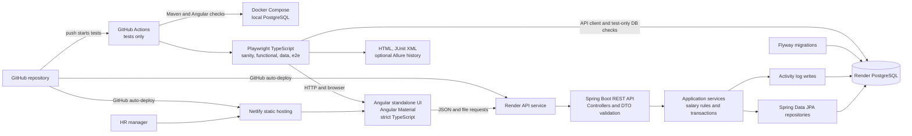
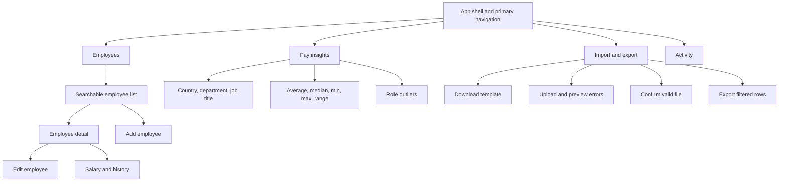

# Salary Management Architecture

## Goal and boundaries

Build a small, public, synthetic-data app that helps an HR manager maintain employee salary records and answer pay questions for a 10,000-person, multi-country organization. Use a Java 17 Spring Boot modular monolith, PostgreSQL, Flyway, and a standalone Angular app with Angular Material and strict TypeScript. Run PostgreSQL locally with Docker Compose. Host the API and database on Render and the static UI on Netlify.

The four modules are people/departments, salary structures/history, Excel import/export, and pay insights. There is no payroll run, tax, payslip, approval workflow, or role-based login. All API boundaries use DTOs. Salary calculations use `BigDecimal` and PostgreSQL `NUMERIC(14,2)`. PostgreSQL performs filtering, pagination, and aggregates.

## System architecture



**Request path:** Angular components call typed API services. Controllers accept request DTOs and validate input. Application services enforce employee and salary rules and write audit events in the same transaction as successful mutations. Repositories use bounded pages or database aggregates. A shared exception handler returns stable field-level validation errors. Flyway is the only schema-change mechanism.

**Local and CI flow:** Docker Compose starts PostgreSQL for local development. GitHub Actions runs Java/Angular unit tests, then tagged Playwright tests against a test database. Test reset support is restricted to test/local profiles. CI retains HTML and JUnit reports and runs tests only. GitHub repository integrations auto-deploy the API to Render and UI to Netlify after pushes; CI contains no deploy jobs. Do not put production secrets in Git or CI artifacts.

## Code structure

Keep one Spring Boot deployable, organized by the approved layer-based packages. Shared helpers live in `shared` packages and are reused; do not copy helpers into services. Backend unit tests mirror the production package paths under `src/test/java`.

```text
backend/src/main/java/.../salary/
  config/ constants/ controller/ dto/ enums/ exception/ mapper/
  model/ repository/ service/ specification/ validator/ util/
  audit/ seed/ shared/
backend/src/test/java/.../salary/
  (same package layout, with focused unit tests)
frontend/src/app/
  core/       app shell, API base service, HTTP interceptors, notifications
  shared/     server-paged table, filter bar, confirm dialog, empty/loading/error states,
              currency display, file upload box, pipes, validators
  features/   employees, salary, insights, import-export, activity
e2e/
  tests/ pages/ fixtures/ support/ playwright.config.ts
```

`dto` contains the common response envelope, request/response DTOs, and shared filter/pagination DTOs. `service` has interfaces and implementations; business rules and transactions live here. `mapper` uses MapStruct. `specification` owns employee list predicates and is reused by filtered Excel export. `exception` provides the global error handler. `audit` writes activity events; `seed` owns deterministic synthetic data. Angular components never call `HttpClient` directly: feature API services use the shared core API base service. Shared Angular components expose stable `data-testid` attributes.

## Database schema

Use five tables. Country and department rows are reference data. Salary versions store the three fixed amounts directly, plus PostgreSQL stored generated columns for gross and net, so a component table is not needed. Imports have no stored batch or row tables: preview and confirm are stateless requests. The activity log is required by scope.

```mermaid
erDiagram
    COUNTRIES ||--o{ EMPLOYEES : employs
    DEPARTMENTS ||--o{ EMPLOYEES : groups
    EMPLOYEES ||--o{ SALARY_VERSIONS : has_history
    EMPLOYEES o|--o{ ACTIVITY_LOG : target_of

    COUNTRIES {
        varchar2 country_code PK
        varchar name UK
        varchar3 currency_code
    }
    DEPARTMENTS {
        uuid department_id PK
        varchar name UK
        boolean active
    }
    EMPLOYEES {
        uuid employee_id PK
        varchar employee_number UK
        varchar first_name
        varchar last_name
        varchar work_email UK_lowercase
        date hire_date
        varchar2 country_code FK
        uuid department_id FK
        varchar job_title
        timestamptz archived_at
        timestamptz created_at
        timestamptz updated_at
    }
    SALARY_VERSIONS {
        uuid salary_version_id PK
        uuid employee_id FK
        date effective_date
        varchar3 currency_code
        numeric basic_amount
        numeric allowances_amount
        numeric deductions_amount
        numeric gross GENERATED_STORED
        numeric net GENERATED_STORED
        timestamptz created_at
    }
    ACTIVITY_LOG {
        bigint activity_id PK
        timestamptz occurred_at
        varchar actor_identifier
        varchar action
        uuid employee_id FK_nullable
        jsonb details
    }
```

### Constraints and indexes

| Table | Constraints and recommended indexes | Why |
|---|---|---|
| `countries` | Primary key `country_code`; unique `name`; check supported country/currency pairs | Keep the five supported country and local-currency mappings valid. Seed US/USD, IN/INR, GB/GBP, DE/EUR, CA/CAD. |
| `departments` | Primary key; unique normalized department name; `active` not null | Prevent duplicate reference values and let forms exclude inactive choices. |
| `employees` | Primary key; unique `employee_number`; unique index on `lower(work_email)`; required hire date/country/department/job title; foreign keys; nonblank name/email checks | Enforce identity and required-field rules in the database as well as the API. |
| `employees` | Index `(archived_at, employee_number)`; indexes on `country_code`, `department_id`; add job-title/search indexes only after the seeded query check | Support default active listing, filters, and stable paging without speculative index sprawl. |
| `salary_versions` | Unique `(employee_id, effective_date)`; FK to employee; nonnegative `NUMERIC(14,2)` inputs; stored generated `gross = basic_amount + allowances_amount`; stored generated `net = basic_amount + allowances_amount - deductions_amount`; `CHECK (net >= 0)` | Preserve one salary snapshot per effective date, calculate values once in PostgreSQL, and enforce no negative net at storage level. |
| `salary_versions` | Index `(employee_id, effective_date DESC)` | Load current and historical salary versions efficiently. |
| `activity_log` | PK; required actor/action/time; optional employee FK using `ON DELETE SET NULL`; action `CHECK`; no update/delete API | Preserve history if a target is unavailable; keep the activity view read-only. |
| `activity_log` | Index `(occurred_at DESC, activity_id DESC)` and `(employee_id, occurred_at DESC)` | Support the newest-first activity screen and employee-specific history. |

The work email uniqueness rule is case-insensitive. Normalize whitespace and case in the service and keep a unique expression index as the final guard. Use stable ordering with an ID tie-breaker for pagination. Do not add `pg_trgm` or other extensions until 10,000-row measurements show a need.

PostgreSQL generated expressions cannot reference another generated column. Therefore `net` uses the algebraically equivalent base-column expression `basic_amount + allowances_amount - deductions_amount`; it equals `gross - deductions_amount`. Insights and tests read the stored `gross` and `net` columns. See [PostgreSQL generated-column restrictions](https://www.postgresql.org/docs/17/ddl-generated-columns.html).

### Tables deliberately omitted

- **Salary component table:** unnecessary while basic, allowances, and deductions are the only supported totals. Three typed `NUMERIC` columns are simpler and make gross/net constraints direct. Revisit only if arbitrary named components become a confirmed need.
- **Import batch and import row tables:** unnecessary and contrary to the stateless import requirement. Preview returns a response without writes; confirm uploads the workbook again and validates it again in one transaction.
- **Currency table:** unnecessary for five fixed country/currency mappings. Country rows carry the local currency. Salary versions also store their currency so past salary history is explicit if an employee changes country.
- **Job title table:** unnecessary for the current scope. Keep a validated, bounded employee field and group it in SQL. Add controlled job-title administration only if HR requires it.
- **Separate audit tables by feature:** unnecessary. One `activity_log` supports employee, salary, import, export, and archive activity.

## REST API

All endpoints are under `/api`. Paginated endpoints cap `size` at 100 and return DTOs. Errors use a stable shape with a message and field errors. The API has no role-based login; only synthetic data may be exposed publicly.

| Method and path | Purpose | Key validation and behavior |
|---|---|---|
| `GET /countries` | List supported country/currency pairs | Return seeded allowlist only. |
| `GET /departments` | List active departments for forms | Stable name order; inactive departments remain available in historical employee records. |
| `GET /employees` | Search, filter, sort, and page active employees | Bound page/size; allowlist sort keys; filters for query, country, department, and job title; exclude archived by default. |
| `POST /employees` | Create employee | Require unique employee number/email, valid hire date, known country/department, nonblank name/job title. |
| `GET /employees/{id}` | Read employee and current salary summary | 404 for unknown ID; current salary may be absent for a newly created person. |
| `PUT /employees/{id}` | Edit employee fields | Same field and uniqueness checks as create; return field errors; never alter prior salary versions. |
| `DELETE /employees/{id}` | Archive employee (soft delete) | Set `archived_at`; repeated archive is safe; preserve salary history and audit trail. |
| `GET /employees/{id}/salary-history` | Read salary versions newest-first | 404 for unknown employee; currency and effective date included. |
| `POST /employees/{id}/salary-history` | Append salary version | Require effective date after latest version, nonnegative amounts, supported currency, and deductions no greater than gross; PostgreSQL generates and stores gross/net. |
| `GET /insights/pay` | Aggregate average, median, min, max, and range by selected dimension | `groupBy` allowlist: country, department, job title; include currency in every group; ignore archived or missing salary. |
| `GET /insights/outliers` | List gross-pay outliers within job-title/country/currency groups | Use this grouping everywhere; IQR rule; require at least five salaries in each group; omit undersized groups. |
| `GET /imports/template` | Download `.xlsx` template | Include documented columns and example-free headers. |
| `POST /imports/preview` | Validate uploaded workbook and return row-level preview/errors | Multipart `.xlsx`; file/row limits; no writes; reject malformed headers, invalid dates/amounts, duplicate IDs/emails, and unsupported country/currency. |
| `POST /imports/confirm` | Re-upload, revalidate, and atomically create all rows | No batch ID or stored preview. Any invalid row means zero writes. Recheck DB uniqueness inside the transaction. |
| `GET /employees/export` | Stream current filtered view as `.xlsx` | Apply same active filters as list; include currency; formula-safe text; record successful export activity. |
| `GET /activity` | Read-only newest-first activity feed | Bounded server-side pagination and optional action filter; no create/update/delete route. |

### Import contract

Columns: employee number, first name, last name, work email, hire date, country code, department, job title, currency, basic, allowances, deductions, salary effective date. Import is create-only and atomic. The preview request does not save its contents. Confirmation uploads the same file and validates it again immediately before a single transaction inserts employees and first salary versions. Duplicate identifiers are errors; existing employees are not updated. If any row is invalid, confirmation writes nothing.

## UI screens and navigation



- **Employees:** table with search, filters, pagination, create action, and archive action. Empty, loading, error, and no-match states are visible.
- **Employee detail:** employee identity, hire date, country, department, and job title; edit action; salary tab with current snapshot and append-only history.
- **Pay insights:** dimension/filter controls, currency-labeled summary table, and role outlier list. Tables are the accessible source for any chart.
- **Import/export:** template link, workbook upload, row-level preview with field errors, atomic confirm state, and filtered export controls.
- **Activity:** read-only newest-first event list with actor, action, target, time, and safe summary details. Link to employee detail when the employee still exists.

## Main HR journeys

### Find and edit an employee

1. HR searches or filters in `/employees`.
2. Angular requests `GET /api/employees` with bounded paging/filter params.
3. HR opens a row; the UI loads `GET /api/employees/{id}`.
4. HR edits employee fields; `PUT /api/employees/{id}` validates and updates in a transaction.
5. The service adds `EMPLOYEE_UPDATED` to `activity_log`; the UI returns to the refreshed detail page.

### Change a salary

1. HR opens the employee's Salary tab and sees the current version/history.
2. HR enters effective date, currency, basic, allowances, and deductions.
3. `POST /api/employees/{id}/salary-history` validates the date and amounts, calculates gross/net, appends a `salary_versions` row, and appends `SALARY_CHANGED` activity in one transaction.
4. The detail screen shows the new current version and the previous version unchanged.

### Answer a pay question

1. HR chooses country, department, or job title and filters in `/insights`.
2. Angular calls `GET /api/insights/pay`; PostgreSQL groups amounts by dimension and currency.
3. The UI shows average, median, min, max/range, and sample size. It never adds or compares different currency amounts.
4. HR opens outliers; `GET /api/insights/outliers` applies IQR to groups keyed by job title, country, and currency, with at least five salaries per group.

### Import a spreadsheet and fix errors

1. HR downloads `GET /api/imports/template`, fills it, and uploads it from `/import-export`.
2. `POST /api/imports/preview` parses without writing, checks row and database constraints, and returns errors with row and column references.
3. HR corrects the file and uploads again until preview has no errors.
4. HR confirms; `POST /api/imports/confirm` receives the file again, repeats all validation, then atomically inserts employees and first salary versions.
5. The service records one `IMPORT_CONFIRMED` event with row count and a safe file hash/summary. Invalid or duplicate files write neither employee data nor a successful-import event.

### Export a filtered view

1. HR sets filters on Employees or in the export screen.
2. Angular sends the same filters to `GET /api/employees/export`.
3. The API streams matching active employee and current salary values without loading the full result into application memory.
4. On successful file generation, the API writes an `EXPORT_COMPLETED` activity entry with row count and non-sensitive filter summary; the browser downloads the workbook.

## Activity logging and identity limit

Write an activity event for employee create/update/archive, salary change, successful import, and successful export. Record actor identifier, action, timestamp, optional employee target, and a small JSON summary (changed field names or row count/filter summary). Do not duplicate salary amounts in audit JSON because salary versions already preserve them. The Activity screen is read-only. Do not expose update/delete activity endpoints; append log entries in the same transaction as successful writes. Preview attempts and failed exports/imports may be omitted from the log for the lean first version.

There is no login, so the app cannot prove a human identity. For the synthetic public demo, the suggested default is one server-configured actor identifier, `assessment-hr-manager`, shown as a demo identity. This records which app actor performed each action, not a verified real-world person. Keep this limitation explicit; do not use the public demo with real compensation data.

## Key trade-offs

- **Modular monolith:** keep people, salary, imports, insights, and activity as backend packages in one deployable service. At 10,000 employees this keeps setup and transactions simple; microservices, queues, and caches add work without a measured need.
- **One salary row per effective date:** three numeric columns make the fixed component model, constraints, and history clear. A flexible component table is deferred until arbitrary components are required.
- **Stateless import:** no batch tables or persisted preview. The client must re-upload at confirm; the API validates again and inserts atomically. This avoids temporary data lifecycle and cleanup jobs.
- **Separate currencies:** each country has a configured local currency; each salary version stores its currency. Insights always group by currency and never invent exchange rates.
- **Soft delete:** archive employees rather than deleting salary history or audit events.
- **No authentication in scope:** public deployment uses synthetic records only. Audit actor attribution is a demo label, not authentication.
- **Database-side work:** filtering, pagination, export selection, median, and aggregates stay in PostgreSQL. Add indexes after measuring seeded queries.
- **Low-cost deployment:** Render/Netlify are fast to publish. Render Free has sleeping services and a 30-day database lifetime; keep it for a short assessment demo and re-evaluate if the app must remain available longer.

## Confirmed design decisions

- The audit actor is a server-configured `assessment-hr-manager` demo identity. It is labeled as unverified because role-based login is out of scope.
- New salary versions must use the employee country’s configured currency. Each salary snapshot stores its currency.
- A new salary effective date must be later than the latest version. One version per employee per effective date.
- Outliers are grouped by job title, country, and currency everywhere. Use IQR and require at least five salaries in each group.
- The five supported countries and department list are seeded reference data and read-only in this version.
- Keep the public demo available for the assessment window. Render Free is acceptable for the short review window; re-create or upgrade before its free database expires if longer access is needed.

## Seed distribution and identifiers

Generate exactly 10,000 fictional employees. Use five countries, ten seeded job titles per country, and 200 employees in every job-title/country/currency group. This makes every role group large enough for the minimum-five outlier rule. Department distribution remains deterministic within those groups. Derive each employee UUID with UUID version 5 from a fixed namespace and the employee number, so repeated seed runs produce identical IDs. Keep the seed command idempotent and separate from the small Playwright fixture reset.

The root `requirements.md`, README, and other earlier project notes may still contain older stack statements. This design uses `docs/requirements.md` as the current requirements document; update the remaining project notes only after this design is confirmed.
