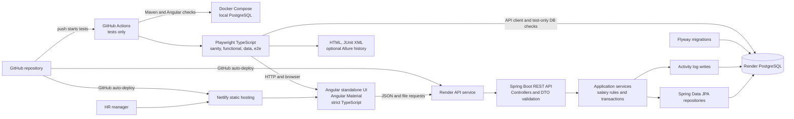
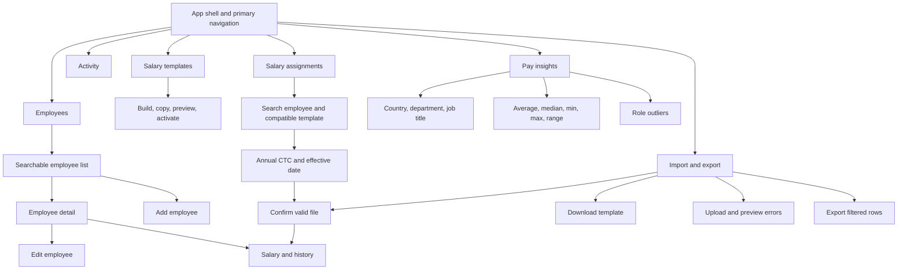
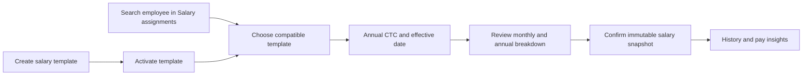

# Salary Management Architecture

## Goal and boundaries

Build a small, public, synthetic-data app that helps an HR manager maintain employee salary records and answer pay questions for a 10,000-person, multi-country organization. Use a Java 17 Spring Boot modular monolith, PostgreSQL, Flyway, and a standalone Angular app with Angular Material and strict TypeScript. Run PostgreSQL locally with Docker Compose. Host the API and database on Render and the static UI on Netlify.

The four modules are people/departments, salary templates and assignments/history, Excel import/export, and pay insights. There is also a read-only activity feed. There is no payroll run, tax, payslip, approval workflow, or role-based login. All API boundaries use DTOs. Salary calculations use `BigDecimal` and PostgreSQL `NUMERIC(14,2)`. PostgreSQL performs filtering, pagination, and aggregates.

## System architecture



**Request path:** Angular components call typed API services. Controllers accept request DTOs and validate input. Application services enforce employee and salary rules and write audit events in the same transaction as successful mutations. Repositories use bounded pages or database aggregates. A shared exception handler returns stable field-level validation errors. Flyway is the only schema-change mechanism.

**Local and CI flow:** Docker Compose starts PostgreSQL for local development. GitHub Actions runs Java/Angular unit tests, then tagged Playwright tests against a test database. Test reset support is restricted to test/local profiles. CI retains HTML and JUnit reports and runs tests only. GitHub repository integrations auto-deploy the API to Render and UI to Netlify after pushes; CI contains no deploy jobs. Do not put production secrets in Git or CI artifacts.

## Code structure

Keep one Spring Boot deployable, organized by the approved layer-based packages. Shared helpers live in `shared` packages and are reused; do not copy helpers into services. Backend unit tests mirror the production package paths under `src/test/java`.

```text
backend/src/main/java/.../salary/
  config/ constants/ controller/ dto/ enums/ exception/ mapper/
  model/ repository/ service/ specification/ validator/ util/
  audit/ seed/ shared/
backend/src/test/java/.../salary/
  (same package layout, with focused unit tests)
frontend/src/app/
  core/       app shell, API base service, HTTP interceptors, notifications
  shared/     server-paged table, filter bar, confirm dialog, empty/loading/error states,
              currency display, file upload box, pipes, validators
  features/   employees, salary, insights, import-export, activity
e2e/
  tests/ pages/ fixtures/ support/ playwright.config.ts
```

`dto` contains the common response envelope, request/response DTOs, and shared filter/pagination DTOs. `service` has interfaces and implementations; business rules and transactions live here. `mapper` uses MapStruct. `specification` owns employee list predicates and is reused by filtered Excel export. `exception` provides the global error handler. `audit` writes activity events; `seed` owns deterministic synthetic data. Angular components never call `HttpClient` directly: feature API services use the shared core API base service. Shared Angular components expose stable `data-testid` attributes.

## Database schema

Use six tables. Country and department rows are reference data. Salary templates store a bounded, validated component definition as JSONB. Salary versions preserve resolved annual and monthly component breakdowns as JSONB so template edits never change history; their fixed totals remain typed numeric columns with generated gross and net. Imports have no stored batch or row tables: preview and confirm are stateless requests. The activity log is required by scope.

```mermaid
erDiagram
    COUNTRIES ||--o{ EMPLOYEES : employs
    DEPARTMENTS ||--o{ EMPLOYEES : groups
    EMPLOYEES ||--o{ SALARY_VERSIONS : has_history
    SALARY_TEMPLATES o|--o{ SALARY_VERSIONS : source_template
    EMPLOYEES o|--o{ ACTIVITY_LOG : target_of
    COUNTRIES ||--o{ SALARY_TEMPLATES : applies_in

    COUNTRIES {
        varchar2 country_code PK
        varchar name UK
        varchar3 currency_code
    }
    DEPARTMENTS {
        uuid department_id PK
        varchar name UK
        boolean active
    }
    EMPLOYEES {
        uuid employee_id PK
        varchar employee_number UK
        varchar first_name
        varchar last_name
        varchar work_email UK_lowercase
        date hire_date
        varchar2 country_code FK
        uuid department_id FK
        varchar job_title
        timestamptz archived_at
        timestamptz created_at
        timestamptz updated_at
    }
    SALARY_VERSIONS {
        uuid salary_version_id PK
        uuid employee_id FK
        date effective_date
        varchar3 currency_code
        numeric basic_amount
        numeric allowances_amount
        numeric deductions_amount
        numeric gross GENERATED_STORED
        numeric net GENERATED_STORED
        uuid template_id FK_nullable
        varchar template_name_snapshot
        bigint template_revision_snapshot
        numeric annual_ctc
        jsonb assignment_breakdown_snapshot
        timestamptz created_at
    }
    SALARY_TEMPLATES {
        uuid template_id PK
        varchar name
        varchar2 country_code FK
        varchar3 currency_code
        varchar status
        bigint revision optimistic_lock
        jsonb components bounded_1_to_20
    }
    ACTIVITY_LOG {
        bigint activity_id PK
        timestamptz occurred_at
        varchar actor_identifier
        varchar action
        uuid employee_id FK_nullable
        jsonb details
    }
```

### Constraints and indexes

| Table | Constraints and recommended indexes | Why |
|---|---|---|
| `countries` | Primary key `country_code`; unique `name`; check supported country/currency pairs | Keep the five supported country and local-currency mappings valid. Seed US/USD, IN/INR, GB/GBP, DE/EUR, CA/CAD. |
| `departments` | Primary key; unique normalized department name; `active` not null | Prevent duplicate reference values and let forms exclude inactive choices. |
| `employees` | Primary key; unique `employee_number`; unique index on `lower(work_email)`; required hire date/country/department/job title; foreign keys; nonblank name/email checks | Enforce identity and required-field rules in the database as well as the API. |
| `employees` | Index `(archived_at, employee_number)`; indexes on `country_code`, `department_id`; add job-title/search indexes only after the seeded query check | Support default active listing, filters, and stable paging without speculative index sprawl. |
| `salary_versions` | Unique `(employee_id, effective_date)`; FK to employee; nonnegative `NUMERIC(14,2)` inputs; stored generated `gross = basic_amount + allowances_amount`; stored generated `net = basic_amount + allowances_amount - deductions_amount`; `CHECK (net >= 0)` | Preserve one salary snapshot per effective date, calculate values once in PostgreSQL, and enforce no negative net at storage level. |
| `salary_versions` | Index `(employee_id, effective_date DESC)` | Load current and historical salary versions efficiently. |
| `salary_templates` | Unique `(country_code, lower(name))`; index `(country_code, status, name)`; JSONB array length 1–20 | Prevent duplicate local template names, support country/status selection, and keep component definitions bounded without another table. |
| `salary_versions` | Nullable template FK with `ON DELETE RESTRICT`; template name/revision snapshots, positive annual CTC, resolved breakdown JSONB | Preserve assignment provenance and the exact calculated component amounts if a template is later revised or archived. Templates are archived, never deleted. |
| `activity_log` | PK; required actor/action/time; optional employee FK using `ON DELETE SET NULL`; action `CHECK`; no update/delete API | Preserve history if a target is unavailable; keep the activity view read-only. |
| `activity_log` | Index `(occurred_at DESC, activity_id DESC)` and `(employee_id, occurred_at DESC)` | Support the newest-first activity screen and employee-specific history. |

The work email uniqueness rule is case-insensitive. Normalize whitespace and case in the service and keep a unique expression index as the final guard. Use stable ordering with an ID tie-breaker for pagination. Do not add `pg_trgm` or other extensions until 10,000-row measurements show a need. Local, CI, and Render databases use PostgreSQL 16.

PostgreSQL generated expressions cannot reference another generated column. Therefore `net` uses the algebraically equivalent base-column expression `basic_amount + allowances_amount - deductions_amount`; it equals `gross - deductions_amount`. Insights and tests read the stored `gross` and `net` columns. The supported engine is PostgreSQL 16. See [PostgreSQL 16 generated-column restrictions](https://www.postgresql.org/docs/16/ddl-generated-columns.html).

### Tables deliberately omitted

- **Salary component table:** unnecessary for the bounded first version. Each template stores at most 20 validated components in JSONB and each assignment snapshots the resolved values; typed base totals keep the database gross/net rules direct. A normalized child table can wait until components need independent reporting or lifecycle.
- **Import batch and import row tables:** unnecessary and contrary to the stateless import requirement. Preview returns a response without writes; confirm uploads the workbook again and validates it again in one transaction.
- **Currency table:** unnecessary for five fixed country/currency mappings. Country rows carry the local currency. Salary versions also store their currency so past salary history is explicit if an employee changes country.
- **Job title table:** unnecessary for the current scope. Keep a validated, bounded employee field and group it in SQL. Add controlled job-title administration only if HR requires it.
- **Separate audit tables by feature:** unnecessary. One `activity_log` supports employee, salary, import, export, and archive activity.

## REST API

All endpoints are under `/api`. Paginated endpoints cap `size` at 100 and return DTOs. Every JSON feature response uses `{ "status": 200, "success": true, "message": "...", "data": ..., "errors": {} }`; errors use the same envelope with the matching HTTP status, `success: false`, and field-level errors where available. Create operations and successful import confirmation return HTTP 201. Template/export downloads remain binary responses, and `/health` keeps its probe response. The API has no role-based login; only synthetic data may be exposed publicly.

| Method and path | Purpose | Key validation and behavior |
|---|---|---|
| `GET /countries` | List supported country/currency pairs | Return seeded allowlist only. |
| `GET /departments` | List active departments for forms | Stable name order; inactive departments remain available in historical employee records. |
| `GET /employees` | Search, filter, sort, and page active employees | Bound page/size; allowlist sort keys; filters for query, country, department, and job title; exclude archived by default. |
| `POST /employees` | Create employee | Require unique employee number/email, valid hire date, known country/department, nonblank name/job title. |
| `GET /employees/{id}` | Read employee and current salary summary | 404 for unknown ID; current salary may be absent for a newly created person. |
| `PUT /employees/{id}` | Edit employee fields | Same field and uniqueness checks as create; return field errors; never alter prior salary versions. |
| `DELETE /employees/{id}` | Archive employee (soft delete) | Set `archived_at`; repeated archive is safe; preserve salary history and audit trail. |
| `GET /employees/{id}/salary-history` | Read salary versions newest-first | 404 for unknown employee; currency and effective date included. |
| `POST /employees/{id}/salary-history` | Legacy direct append for integrations; not exposed in the HR UI | Require effective date after latest version, nonnegative amounts, employee-country currency, and deductions no greater than gross; PostgreSQL generates gross/net. The HR salary workflow uses template assignment. |
| `GET /salary-templates` | Search and page templates | Bounded page size; optional country/status/search; stable name ordering. |
| `POST /salary-templates` | Create a salary template | Supported country, matching configured currency, unique country/name, 1–20 valid components, exactly one basic and one balancing allowance. |
| `PUT /salary-templates/{id}` | Revise template definition or status | Require current revision; conflict on stale edit; edits never mutate salary history. |
| `POST /salary-assignments/preview` | Calculate annual and monthly CTC breakdown | Active template, same employee country, current template revision, positive two-decimal annual CTC, date on/after hire and after latest salary. No write. |
| `POST /salary-assignments` | Assign template and append salary snapshot | Revalidate and lock employee/template; reject stale revision, archived employee, invalid date, negative balancing remainder, or negative net; write salary and audit atomically. |
| `GET /insights/pay` | Aggregate average, median, min, max, and range by selected dimension | `groupBy` allowlist: country, department, job title; include currency in every group; ignore archived or missing salary. |
| `GET /insights/outliers` | List gross-pay outliers within job-title/country/currency groups | Use this grouping everywhere; IQR rule; require at least five salaries in each group; omit undersized groups. |
| `GET /imports/template` | Download `.xlsx` template | Include documented columns and example-free headers. |
| `POST /imports/preview` | Validate uploaded workbook and return row-level preview/errors | Multipart `.xlsx`; file/row limits; no writes; reject malformed headers, invalid dates/amounts, duplicate IDs/emails, and unsupported country/currency. |
| `POST /imports/confirm` | Re-upload, revalidate, and atomically create all rows | No batch ID or stored preview. Any invalid row means zero writes. Recheck DB uniqueness inside the transaction. |
| `GET /employees/export` | Stream current filtered view as `.xlsx` | Apply same active filters as list; include currency; formula-safe text; record successful export activity. |
| `GET /activity` | Read-only newest-first activity feed | Bounded server-side pagination and optional action filter; no create/update/delete route. |

### Import contract

Columns: employee number, first name, last name, work email, hire date, country code, department, job title, currency, basic, allowances, deductions, salary effective date. Import is create-only and atomic. The preview request does not save its contents. Confirmation uploads the same file and validates it again immediately before a single transaction inserts employees and first salary versions. Duplicate identifiers are errors; existing employees are not updated. If any row is invalid, confirmation writes nothing.

## UI screens and navigation



- **Employees:** table with search, filters, pagination, create action, and archive action. Empty, loading, error, and no-match states are visible.
- **Employee detail:** employee identity, hire date, country, department, and job title; edit action; salary tab with current snapshot and append-only history. A direct salary action opens assignment with that employee preselected.
- **Salary templates:** searchable country/status list, clear status badges, create/copy/edit/preview actions, and a compact component editor. Drafts can be saved; only valid templates can be activated; archived templates remain visible but cannot be assigned.
- **Salary assignments:** one workflow to search by employee identity, choose an active country-compatible template, enter annual CTC/effective date, preview monthly/yearly results, confirm, and see the prior salary context. HR does not need to open employee records one by one.
- **Pay insights:** dimension/filter controls, currency-labeled summary table, and role outlier list. Tables are the accessible source for any chart.
- **Import/export:** template link, workbook upload, row-level preview with field errors, atomic confirm state, and filtered export controls.
- **Activity:** read-only newest-first event list with actor, action, target, time, and safe summary details. Link to employee detail when the employee still exists.

## Main HR journeys

### Find and edit an employee

1. HR searches or filters in `/employees`.
2. Angular requests `GET /api/employees` with bounded paging/filter params.
3. HR opens a row; the UI loads `GET /api/employees/{id}`.
4. HR edits employee fields; `PUT /api/employees/{id}` validates and updates in a transaction.
5. The service adds `EMPLOYEE_UPDATED` to `activity_log`; the UI returns to the refreshed detail page.

### Create and assign a salary template

1. HR opens Salary templates, chooses a country and creates a short named template with basic, allowances, employer contributions, deductions, and one balancing allowance. Each component uses a fixed annual amount or a supported percentage rule.
2. HR previews and activates the valid template. `POST /api/salary-templates` or `PUT /api/salary-templates/{id}` saves its bounded definition and audit event.
3. HR opens Salary assignments (or uses the direct employee action), searches by name, email, or employee number, and selects an active template for that employee's country.
4. HR enters annual CTC and effective date. `POST /api/salary-assignments/preview` calculates annual and monthly figures; employer contributions are part of CTC, gross is basic plus allowances, and net is gross less employee deductions.
5. HR reviews the current salary context and confirms. The API revalidates the template revision and date, locks the employee row, appends the immutable salary snapshot and audit event in one transaction, then shows the updated history.

### Answer a pay question

1. HR chooses country, department, or job title and filters in `/insights`.
2. Angular calls `GET /api/insights/pay`; PostgreSQL groups amounts by dimension and currency.
3. The UI shows average, median, min, max/range, and sample size. It never adds or compares different currency amounts.
4. HR opens outliers; `GET /api/insights/outliers` applies IQR to groups keyed by job title, country, and currency, with at least five salaries per group.

### Import a spreadsheet and fix errors

1. HR downloads `GET /api/imports/template`, fills it, and uploads it from `/import-export`.
2. `POST /api/imports/preview` parses without writing, checks row and database constraints, and returns errors with row and column references.
3. HR corrects the file and uploads again until preview has no errors.
4. HR confirms; `POST /api/imports/confirm` receives the file again, repeats all validation, then atomically inserts employees and first salary versions.
5. The service records one `IMPORT_CONFIRMED` event with row count and a safe file hash/summary. Invalid or duplicate files write neither employee data nor a successful-import event.

### Export a filtered view

1. HR sets filters on Employees or in the export screen.
2. Angular sends the same filters to `GET /api/employees/export`.
3. The API streams matching active employee and current salary values without loading the full result into application memory.
4. On successful file generation, the API writes an `EXPORT_COMPLETED` activity entry with row count and non-sensitive filter summary; the browser downloads the workbook.

## Activity logging and identity limit

Write an activity event for employee create/update/archive, salary change, successful import, and successful export. Record actor identifier, action, timestamp, optional employee target, and a small JSON summary (changed field names or row count/filter summary). Do not duplicate salary amounts in audit JSON because salary versions already preserve them. The Activity screen is read-only. Do not expose update/delete activity endpoints; append log entries in the same transaction as successful writes. Preview attempts and failed exports/imports may be omitted from the log for the lean first version.

There is no login, so the app cannot prove a human identity. For the synthetic public demo, the suggested default is one server-configured actor identifier, `assessment-hr-manager`, shown as a demo identity. This records which app actor performed each action, not a verified real-world person. Keep this limitation explicit; do not use the public demo with real compensation data.

## Key trade-offs

- **Modular monolith:** keep people, salary, imports, insights, and activity as backend packages in one deployable service. At 10,000 employees this keeps setup and transactions simple; microservices, queues, and caches add work without a measured need.
- **Bounded template JSON:** one JSONB array capped at 20 validated components avoids a component table for the assessment. Each salary version stores the resolved annual/monthly values, so template revisions cannot rewrite history. Normalize components only if independent component reporting becomes necessary.
- **One salary row per effective date:** salary versions keep typed basic, allowance, and deduction totals for direct generated-column constraints, alongside immutable template provenance and breakdown snapshots.
- **Stateless import:** no batch tables or persisted preview. The client must re-upload at confirm; the API validates again and inserts atomically. This avoids temporary data lifecycle and cleanup jobs.
- **Separate currencies:** each country has a configured local currency; each salary version stores its currency. Insights always group by currency and never invent exchange rates.
- **Soft delete:** archive employees rather than deleting salary history or audit events.
- **No authentication in scope:** public deployment uses synthetic records only. Audit actor attribution is a demo label, not authentication.
- **Database-side work:** filtering, pagination, export selection, median, and aggregates stay in PostgreSQL. Add indexes after measuring seeded queries.
- **Low-cost deployment:** Render/Netlify are fast to publish. Render Free has sleeping services and a 30-day database lifetime; keep it for a short assessment demo and re-evaluate if the app must remain available longer.

## Confirmed design decisions

- The audit actor is a server-configured `assessment-hr-manager` demo identity. It is labeled as unverified because role-based login is out of scope.
- New salary versions must use the employee country’s configured currency. Each salary snapshot stores its currency.
- A new salary effective date must be later than the latest version. One version per employee per effective date.
- Outliers are grouped by job title, country, and currency everywhere. Use IQR and require at least five salaries in each group.
- The five supported countries and department list are seeded reference data and read-only in this version.
- Keep the public demo available for the assessment window. Render Free is acceptable for the short review window; re-create or upgrade before its free database expires if longer access is needed.

## Seed distribution and identifiers

Generate exactly 10,000 fictional employees. Use five countries, ten seeded job titles per country, and 200 employees in every job-title/country/currency group. This makes every role group large enough for the minimum-five outlier rule. Department distribution remains deterministic within those groups. Derive each employee UUID with UUID version 5 from a fixed namespace and the employee number, so repeated seed runs produce identical IDs. Keep the seed command idempotent and separate from the small Playwright fixture reset.

The root `requirements.md`, README, and other earlier project notes may still contain older stack statements. This design uses `docs/requirements.md` as the current requirements document; update the remaining project notes only after this design is confirmed.


## Backend layering review (14 October 2026)

- Controllers use service interfaces and typed response DTOs. Reference lists use database DTO projections with ordering and active-department filtering in the query.
- InsightsRepository owns PostgreSQL aggregate and outlier SQL. SalaryExportRepository selects current salaries for one employee page. EmployeeImportRepository owns both batch inserts and requires an existing transaction.
- Services own business validation, transaction boundaries, and audit orchestration. No service in the application service package directly uses JdbcTemplate.
- Import parsing necessarily iterates workbook cells. It is limited to 500 rows and uses bulk identity checks. Export iterates pages of 500 records and writes a streaming workbook. These loops do not replace database filters.
- Keep constructor injection and centralized exception advice. JSON error status matches HTTP status, including HTTP 413 for multipart uploads over the configured limit. Downloads retain their binary response type.
- Local server version checked: PostgreSQL 16.15. Compose, CI, and Render configuration target major version 16.


## Employee sorting and filtered export

Employee list and export accept `sortBy` and `direction`. Defaults are employeeNumber and asc. Supported fields are employeeNumber, name, workEmail, hireDate, country, department, and jobTitle. EmployeeSort maps public names to trusted JPA paths and rejects unknown values with HTTP 400. Name sorts by first and last name. Every sort adds employee ID as a stable tie-breaker. Sorting and filtering occur in PostgreSQL before pagination. The directory Export view action passes its current filters and sort, and exports all matches.


## Responsive workspace design

Use a compact top bar with a hamburger that opens a left side menu as an overlay on both desktop and mobile. Keep the menu closed by default and close it after route selection, Escape, or backdrop click. Keep blue for primary actions and the active route, neutral surfaces elsewhere, and use status badges only when they help identify currency or record status. Main headings, cards, filters, form fields, and buttons use shared theme tokens for typography, spacing, borders, hover and focus behavior. Form labels stay above their controls; desktop filter rows align in a grid and stack at the mobile breakpoint. Feature screens include short visible page guides with evenly spaced steps. Icon-only actions have tooltips and accessible labels. Wide tables scroll inside their own containers and leave pagination reachable.

The user supplied screenshots clarifying a separate salary-template builder followed by employee CTC assignment and calculation preview. CTC and template rules are confirmed in the following workflow section. Implementation and verification remain delivery gates.


## Confirmed template and assignment workflow

The user accepted annual CTC, fixed amounts, percentages of CTC/basic, one balancing allowance, and employer contributions distinct from gross. Keep the workflow short. HR must be able to assign salary directly without navigating through employee edit screens.

- Salary templates: searchable list with Draft/Active/Archived badges; create/edit component rows; copy and preview. A template belongs to one country and uses its currency. Component categories are BASIC, ALLOWANCE, EMPLOYER_CONTRIBUTION, and DEDUCTION. One basic component and exactly one balancing allowance are required for activation. No tax or payroll engine.
- Salary assignments: search employees directly by name/email/number, select an employee, choose a compatible active template, enter annual CTC and effective date, review monthly/yearly totals, then confirm. Show the previous salary/effective date and clear validation errors. The employee directory offers a direct salary action.
- Store templates in one salary_templates table with validated component JSON and optimistic revision. Store the template identity/revision and resolved component JSON on the immutable salary version. Template edits cannot change assigned salaries.
- All fixed component inputs are annual. Percentage rates have up to two decimals. Calculate basic first, then other fixed/percentage components, then assign the CTC remainder to the balancing allowance. Reject negative remainder and negative net. Calculate monthly with two-decimal HALF_UP amounts and a monthly balancing remainder. Annual and monthly amounts may differ by rounding when multiplied by twelve; label the two views.
- Preview and confirm use the same server calculator. Confirm revalidates the employee, active template, submitted revision, country/currency and effective date in a transaction. Lock the employee row when saving to serialize salary changes.
- Template list and employee search remain server paginated. Template rows are bounded (maximum 20 components). Status changes and assignments are audited.


